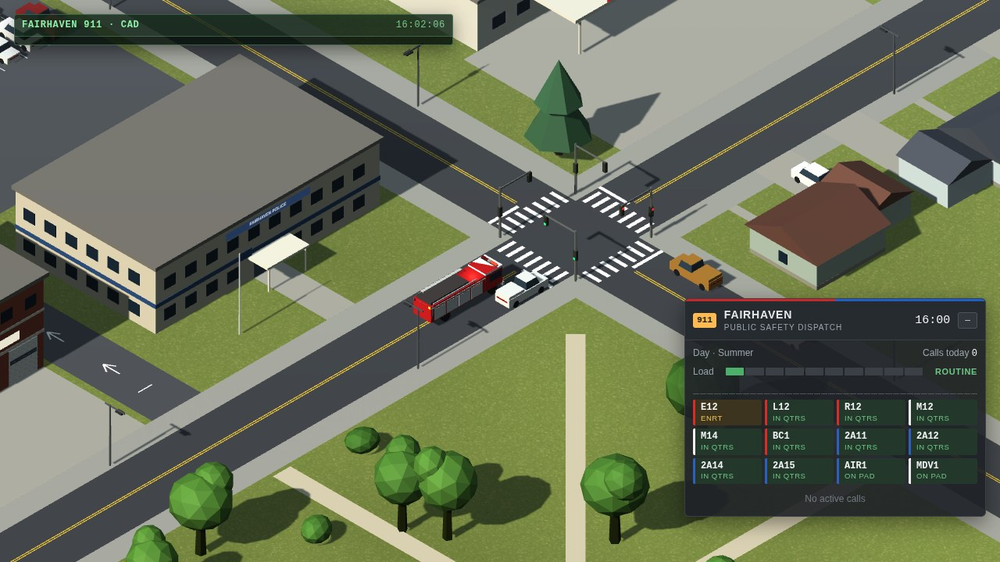
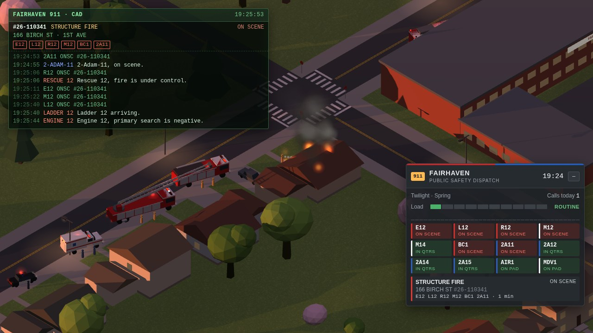
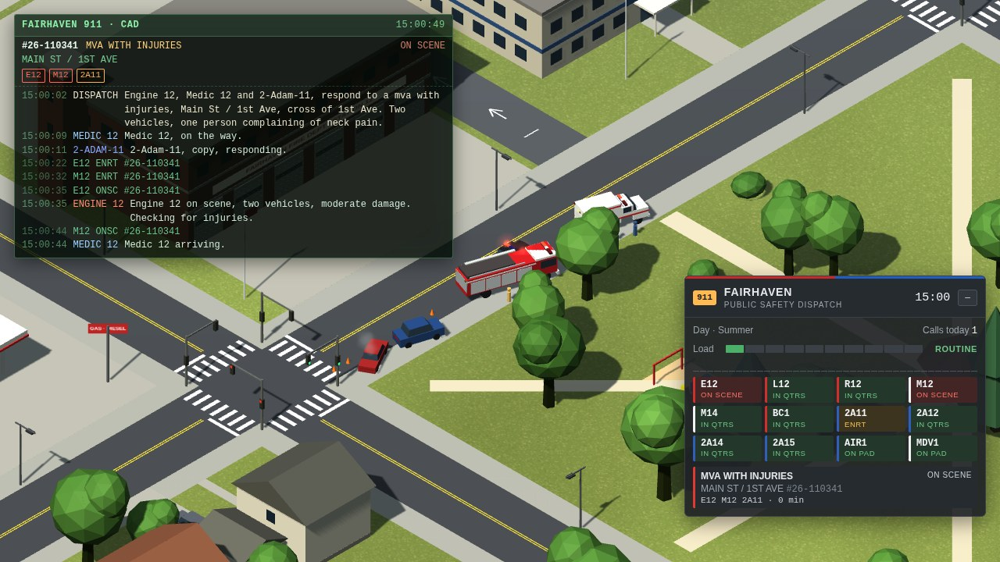
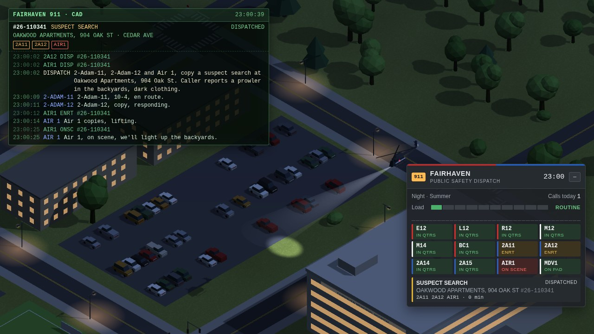
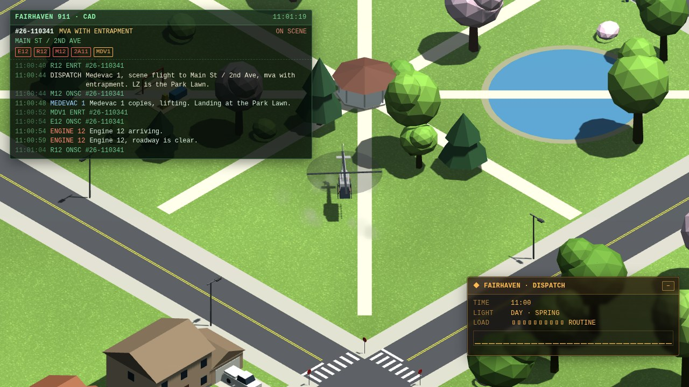

# Code 3 — web wallpaper for Wallpaper Engine

An isometric small town and its public safety center: a fire station, a police station and EMS, with the hospital,
houses, a school and a park around them. Engines, ladders, ambulances, patrol cars and two helicopters roll out to
calls on their own, lights and sirens, while the town's traffic pulls over for them; a dispatch terminal (CAD) logs the
radio traffic. The music sets how busy the town is, the light bars flash to the beat, the time of day follows your PC
clock and the town follows the seasons.
From the author of [Forward Air Base](https://github.com/wladbelsky/air-base-wallpaper) and
[Carrier Strike Group](https://github.com/wladbelsky/carrier-wallpaper).

- **Live demo** (runs in the browser): https://wladbelsky.github.io/Code3/

## Install

From source:

1. Copy the `Code 3` folder into
   `...\Steam\steamapps\common\wallpaper_engine\projects\myprojects\`,
   or in Wallpaper Engine choose **Open Wallpaper → Open from File** and pick `project.json`.
2. Audio reaction needs audio recording enabled in the WE settings (it is on by default).
3. The panel's collapse button needs mouse input enabled in WE. The mouse never moves the camera.

## Performance

Light on purpose: the town is a few hundred draw calls, the simulation a fraction of a millisecond a frame. To go
lighter still: lower the **FPS limit** in Wallpaper Engine's settings (30 is plenty), turn **Shadows** off, lower
**Civilian traffic**. Wallpaper Engine pauses it under fullscreen apps by default.

## The town

- **The public safety center** in the middle: a fire station with six drive-through bays and roll-up doors
  (Station 12), the quarters upstairs and a hose tower, the police station with its lot, and a helipad.
- Around it: the hospital with its ER and a helipad on the roof, a gas station and a strip mall, the high school and
  its field, apartments, a park with a pond, and three blocks of houses, each with its own address.
- Streets with crosswalks, traffic lights at the main crossings and all-way stops elsewhere; street lights at night.
- **Seasons** (property **Season**: by the PC date, or fixed): snow on the roofs and firs in winter, green in spring
  and summer, golden and red trees in autumn. **Snowfall / falling leaves** can be switched off.
- **Town name** property: on the station, police, hospital and school signs and on the panel.

## Units

| Unit | Home | |
|---|---|---|
| Engine 12, Ladder 12, Rescue 12 | fire station bays | the ladder's aerial lies over the cab |
| Medic 12, Medic 14 | fire station bays | Type I ambulances |
| Battalion 1 | fire station bay | the chief's SUV |
| 2-Adam-11 … 15 | police lot | patrol cars |
| Air 1 | the helipad by the station | the police helicopter, a searchlight under the nose |
| Medevac 1 | the hospital's roof pad | the air ambulance |

- Units roll out with lights flashing (on the beat while music plays), keep right, slow down through red lights and
  stop signs, and pull over at the curb on scene; on the way back they stop at red lights.
- The fire station has drive-through bays: out through the front doors onto Main St, back in from the yard behind,
  up the lane beside the station; patrol cars back out of their stalls and pull in nose first.

- **Traffic**: cars pass through town by the lights and the stop signs. When a unit comes up with lights and siren they
  pull over to the curb and stop, and the unit passes on the centre line; otherwise they give way to units turning across,
  and back off a little if one has to get by. Property **Civilian traffic** sets how many by day (fewer at night).

## Dispatch

Calls come in on their own: medical calls and falls, fire alarms, structure fires, crashes, vehicle fires, gas odors,
traffic stops, suspicious vehicles, burglary alarms, disturbances, mutual aid out of town. The dispatcher sends the
free units each call needs (a structure fire gets the engine, the ladder, the rescue, a medic, the chief and a patrol
car); what is missing joins as units come free. The **dispatch terminal** (CAD) shows the active calls with their
units' status and the radio traffic: the dispatcher toning out, units answering, size-ups on arrival, updates, units
clearing — plain language for fire and EMS, 10-codes for the police. Properties: **Dispatch terminal** on / off and its
position, **Calls when it is quiet** (how often calls come in without music).

## On scene

- **House fires** grow until the first engine puts water on them: the engine's crew runs a line from the yard, the
  ladder raises its aerial over the roof; flames and black smoke, then white steam once it is knocked down. The units
  stay until it is out; the ladder beds its aerial before it leaves.
- **Crashes**: two wrecks near the crossing, steam from a radiator, cones; **car fires** burn until the engine's water
  puts them out and the car is left charred.
- **Crews** stand by their units: firefighters, EMTs, officers.
- **Transports**: medics take patients to the hospital's ER (in under the canopy), wait there a while and come home.

| A house fire at dusk | A crash at a crossing |
|---|---|
|  |  |

## Helicopters

- **Air 1** goes up on suspect searches (and sometimes on a burglary alarm): it orbits over the yards, and at night its
  searchlight sweeps the ground below. When the search is over it flies home, hovers over its pad and settles.
- **Medevac 1**: on a crash with someone trapped, the first unit in asks for it; it lands at the nearest landing zone
  (the high school field or the park lawn), dust blowing out under the rotor, and then flies the patient to the
  hospital's roof. Out-of-town requests take it off the screen and back with a patient.

| Air 1 over a night search | Medevac 1 at the park landing zone |
|---|---|
|  |  |

## The dispatch board

The panel shows the clock, the day and the season, today's calls, the **load** and the sound, every unit and helicopter
as a status tile (its service's colour on the edge; green available, amber dispatched / en route, red on scene, blue
transporting) and the open calls as cards. Properties: **Show the panel**, its position, scale and **accent colour**.
With **Remember the CAD log and the day's calls** on, a restart keeps the call numbers running on, today's count, the
last radio lines and the load.

## Music

The music doesn't start a fight here: it sets how busy the town is. The longer and louder it plays, the higher the
**LOAD** on the panel (ROUTINE → BUSY → HEAVY → SURGE); in silence it calms down slowly.

## Browser preview

Serve the folder (`python -m http.server 8766`) and open `http://localhost:8766/`. The ⚙ Settings drawer mirrors the
wallpaper properties and has a demo beat and an audio-file player. URL parameters: `?hour=22`, `?zoom=150`,
`?season=winter`, `?demo=1`, `?ts=4` (time scale).

## Tests

`powershell -ExecutionPolicy Bypass -File tools/test.ps1` runs the Playwright suite in Docker (the same image as CI).
