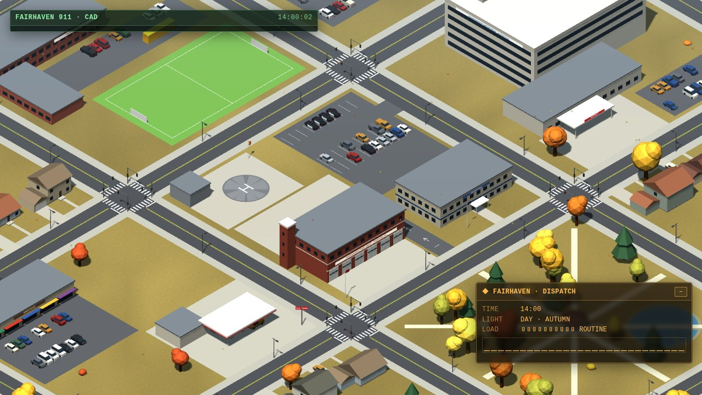
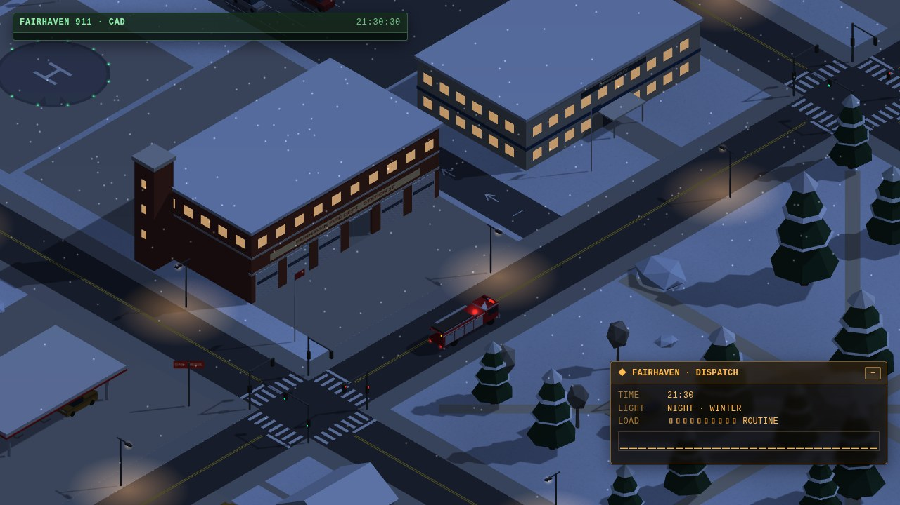
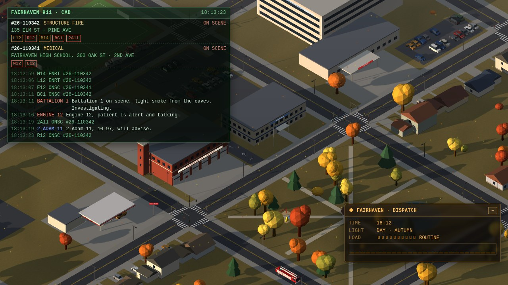

# Code 3 — web wallpaper for Wallpaper Engine

An isometric small town and its public safety center: a fire station, a police station and EMS, with the hospital,
houses, a school and a park around them. The time of day follows your PC clock and the town follows the seasons.
From the author of [Forward Air Base](https://github.com/wladbelsky/air-base-wallpaper) and
[Carrier Strike Group](https://github.com/wladbelsky/carrier-wallpaper).

> **Work in progress.** The town, the units, the calls and the dispatch terminal are in; the scenes on site (fire, crashes, transports) are next.

- **Live demo** (runs in the browser): https://wladbelsky.github.io/Code3/ (once published)

## Install

From source:

1. Copy the `Code 3` folder into
   `...\Steam\steamapps\common\wallpaper_engine\projects\myprojects\`,
   or in Wallpaper Engine choose **Open Wallpaper → Open from File** and pick `project.json`.
2. Audio reaction needs audio recording enabled in the WE settings (it is on by default).

## The town

- **The public safety center** in the middle: a fire station with six drive-through bays and roll-up doors
  (Station 12), the quarters upstairs and a hose tower, the police station with its lot, and a helipad.
- Around it: the hospital with its ER and a helipad on the roof, a gas station and a strip mall, the high school and
  its field, apartments, a park with a pond, and three blocks of houses, each with its own address.
- Streets with crosswalks, traffic lights at the main crossings and all-way stops elsewhere; street lights at night.
- **Seasons** (property **Season**: by the PC date, or fixed): snow on the roofs and firs in winter, green in spring
  and summer, golden and red trees in autumn. **Snowfall / falling leaves** can be switched off.
- **Town name** property: on the station, police, hospital and school signs and on the panel.

## Units

| Unit | Home | |
|---|---|---|
| Engine 12, Ladder 12, Rescue 12 | fire station bays | the ladder's aerial lies over the cab |
| Medic 12, Medic 14 | fire station bays | Type I ambulances |
| Battalion 1 | fire station bay | the chief's SUV |
| 2-Adam-11 … 15 | police lot | patrol cars |

- Units roll out with lights flashing (on the beat while music plays), keep right, slow down through red lights and
  stop signs, and pull over at the curb on scene; on the way back they stop at red lights.
- The fire station has drive-through bays: out through the front doors onto Main St, back in from the yard behind,
  up the lane beside the station; patrol cars back out of their stalls and pull in nose first.

## Dispatch

Calls come in on their own: medical calls and falls, fire alarms, structure fires, crashes, vehicle fires, gas odors,
traffic stops, suspicious vehicles, burglary alarms, disturbances, mutual aid out of town. The dispatcher sends the
free units each call needs (a structure fire gets the engine, the ladder, the rescue, a medic, the chief and a patrol
car); what is missing joins as units come free. The **dispatch terminal** (CAD) shows the active calls with their
units' status and the radio traffic: the dispatcher toning out, units answering, size-ups on arrival, updates, units
clearing — plain language for fire and EMS, 10-codes for the police. Properties: **Dispatch terminal** on / off and its
position, **Calls when it is quiet** (how often calls come in without music).

## Music

The music doesn't start a fight here: it sets how busy the town is. The longer and louder it plays, the higher the
**LOAD** on the panel (ROUTINE → BUSY → HEAVY → SURGE); in silence it calms down slowly.

## Browser preview

Serve the folder (`python -m http.server 8766`) and open `http://localhost:8766/`. The ⚙ SETTINGS drawer mirrors the
wallpaper properties and has a demo beat and an audio-file player. URL parameters: `?hour=22`, `?zoom=150`,
`?season=winter`, `?demo=1`, `?ts=4` (time scale).

## Tests

`powershell -ExecutionPolicy Bypass -File tools/test.ps1` runs the Playwright suite in Docker (the same image as CI).
